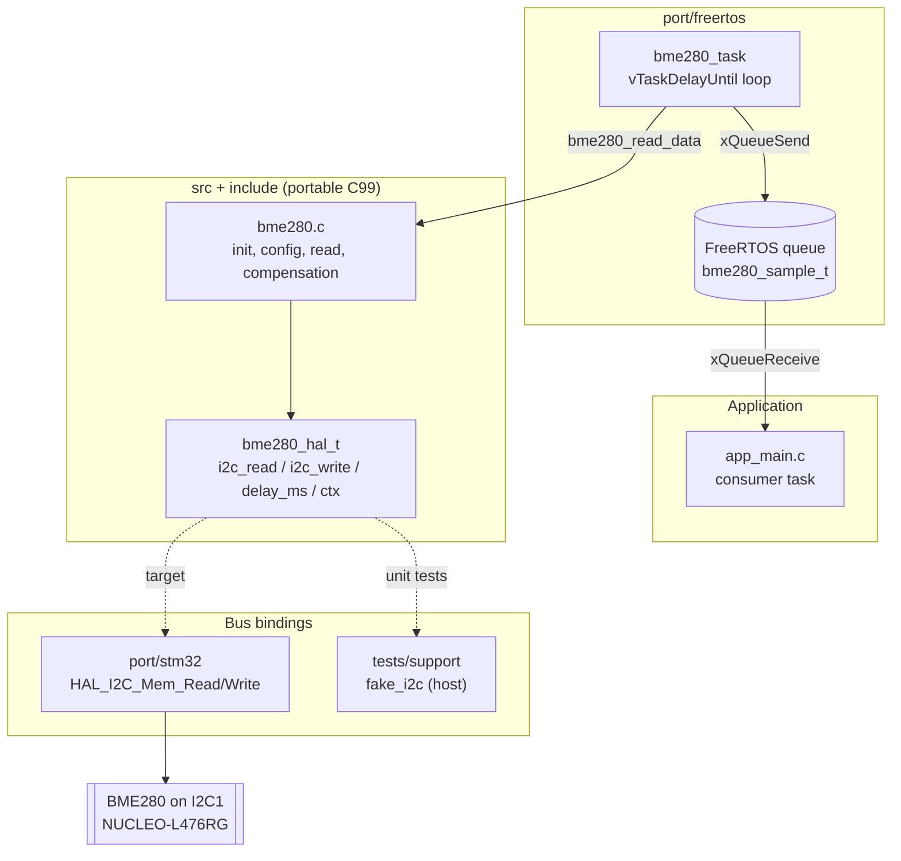

# STM32 + FreeRTOS BME280 I2C sensor driver

[](https://github.com/AbdessettarBenHassen/stm32-freertos-i2c-sensor-driver/actions/workflows/ci.yml)


[](LICENSE)

A portable, hardware independent C99 driver for the **Bosch BME280** temperature, pressure
and humidity sensor, with a **FreeRTOS** sampling task and an **STM32 Cube HAL** port.
The whole driver is unit tested on a PC against a fake I2C bus, so it can be developed
and verified without a board.

## Highlights

- **Portable core**: no MCU or RTOS code in `src/`. The bus is injected through a small
  HAL struct of function pointers (`i2c_read`, `i2c_write`, `delay_ms`, `ctx`).
- **Integer only compensation**: Bosch reference formulas (32-bit temperature and humidity,
  64-bit pressure), no floating point needed on a Cortex-M0/M4 without FPU.
- **FreeRTOS task**: fixed rate sampling with `vTaskDelayUntil()`, results published to a
  queue, non blocking producer with a dropped sample counter.
- **STM32 port**: thin binding over `HAL_I2C_Mem_Read/Write`, tested on the host against a
  recording stub of the Cube HAL.
- **Tested on the host**: Unity unit tests with a fake I2C bus (register map, error
  injection, NACK), plus an optional run of the real task on the FreeRTOS POSIX simulator.
- **Quality gates in CI**: GCC and Clang with `-Werror`, ASan + UBSan, clang-format,
  cppcheck.

## Architecture



## Repository layout

```
.
├── include/                 Public API
│   ├── bme280.h             Driver API (Doxygen documented)
│   ├── bme280_hal.h         Bus abstraction (function pointers)
│   └── bme280_regs.h        Register map and constants
├── src/bme280.c             Portable driver core
├── port/
│   ├── stm32/               STM32 Cube HAL binding (I2C + delay)
│   └── freertos/            Periodic sampling task + queue
├── examples/
│   ├── host_simulated/      PC demo on the fake bus
│   └── nucleo_l476rg/       NUCLEO-L476RG application (CubeMX project glue)
├── tests/
│   ├── support/             Fake I2C bus, Cube HAL stub, sensor fixture
│   ├── freertos_sim/        Task test on the FreeRTOS POSIX simulator (optional)
│   └── test_*.c             Unity unit tests
├── cmake/                   Compiler warning helpers
├── docs/GUIDE_FR.md         Step by step implementation guide (French)
├── .github/workflows/ci.yml GitHub Actions pipeline
└── CMakePresets.json        dev / asan / freertos-sim presets
```

## Build and test on a PC

Requirements: CMake >= 3.18, a C99 compiler (GCC or Clang), Ninja or Make.
Unity (v2.6.0) is fetched automatically by CMake.

```bash
# Configure, build and run the unit tests
cmake -S . -B build -DBME280_WERROR=ON
cmake --build build
ctest --test-dir build --output-on-failure

# Same thing with AddressSanitizer + UndefinedBehaviorSanitizer
cmake -S . -B build-asan -DBME280_SANITIZE=ON
cmake --build build-asan && ctest --test-dir build-asan --output-on-failure

# Run the FreeRTOS task on the POSIX simulator (downloads FreeRTOS-Kernel V11.1.0)
cmake -S . -B build-sim -DBME280_FREERTOS_SIM=ON
cmake --build build-sim && ctest --test-dir build-sim -L freertos --output-on-failure

# PC demo on the simulated sensor
./build/examples/host_simulated/bme280_host_demo
```

Or with presets: `cmake --preset dev && cmake --build --preset dev && ctest --preset dev`.

Offline build: pass `-DFETCHCONTENT_SOURCE_DIR_UNITY=/path/to/Unity` (and
`-DFETCHCONTENT_SOURCE_DIR_FREERTOS_KERNEL=/path/to/FreeRTOS-Kernel` for the simulator).

| CMake option | Default | Effect |
|---|---|---|
| `BME280_BUILD_TESTS` | ON (top level) | Unit tests |
| `BME280_BUILD_EXAMPLES` | ON (top level) | Host demo |
| `BME280_WERROR` | OFF | Treat warnings as errors |
| `BME280_SANITIZE` | OFF | ASan + UBSan |
| `BME280_FREERTOS_SIM` | OFF | FreeRTOS POSIX simulation test |

Formatting and static analysis, as run in CI:

```bash
git ls-files '*.c' '*.h' | xargs clang-format --dry-run --Werror
cppcheck --enable=warning,performance,portability --std=c99 --error-exitcode=1 \
  --inline-suppr --suppress=missingIncludeSystem \
  -I include -I tests/support -I tests/support/stm32_hal_stub -I port/stm32 \
  '-DBME280_STM32_HAL_HEADER="stm32_hal_stub.h"' \
  src tests/*.c tests/support port/stm32 examples/host_simulated
```

## Usage

```c
#include "bme280.h"
#include "bme280_stm32.h"

static bme280_stm32_ctx_t i2c_ctx = { .hi2c = &hi2c1, .timeout_ms = 50 };
static bme280_hal_t hal;
static bme280_dev_t dev;

bme280_stm32_hal_bind(&hal, &i2c_ctx);
if (bme280_init(&dev, &hal, BME280_I2C_ADDR_PRIMARY) == BME280_OK) {
    const bme280_config_t cfg = BME280_CONFIG_DEFAULT;
    bme280_data_t d;
    bme280_set_config(&dev, &cfg);
    bme280_read_data(&dev, &d);
    /* d.temperature: 0.01 degC, d.pressure: Pa in Q24.8, d.humidity: %RH in Q22.10 */
}
```

Porting to another MCU only requires three callbacks matching `bme280_hal.h`.

## Hardware

Tested target: **NUCLEO-L476RG** (STM32L476RG). Any STM32F4 Nucleo works the same way,
just define `BME280_STM32_HAL_HEADER="stm32f4xx_hal.h"`.

| BME280 breakout pin | NUCLEO-L476RG | Note |
|---|---|---|
| VCC / VIN | 3V3 | Check that the breakout accepts 3.3 V |
| GND | GND | |
| SCL | PB8 (Arduino D15) | I2C1_SCL, 400 kHz |
| SDA | PB9 (Arduino D14) | I2C1_SDA |
| SDO | GND | I2C address 0x76 (to VDDIO for 0x77) |
| CSB | VDDIO (3V3) | Selects I2C mode |

Most breakouts already have 4.7 kOhm pull-ups on SDA/SCL. CubeMX settings and the
expected UART output are in [examples/nucleo_l476rg](examples/nucleo_l476rg/README.md).

## Roadmap

- [x] Project structure, CMake, CI, formatting and static analysis
- [x] Public API, HAL abstraction, fake I2C bus and unit tests
- [x] Host demo and FreeRTOS POSIX simulation harness
- [ ] Register read/write helpers
- [ ] Calibration parsing (0x88..0xA1, 0xE1..0xE7)
- [ ] Integer compensation (temperature, pressure, humidity)
- [ ] STM32 Cube HAL binding
- [ ] FreeRTOS sampling task
- [ ] Bring-up on NUCLEO-L476RG, logic analyzer capture in `docs/`
- [ ] Release v0.1.0
- [ ] Next: DMA / interrupt driven I2C, low power forced mode, SPI transport

## References

- Bosch Sensortec, *BME280 Combined humidity and pressure sensor datasheet*, BST-BME280-DS002
- ST, *UM1884 Description of STM32L4/L4+ HAL and low-layer drivers*
- FreeRTOS, *Mastering the FreeRTOS Real Time Kernel*

## License

[MIT](LICENSE) © 2026 Abdessettar Ben Hassen
